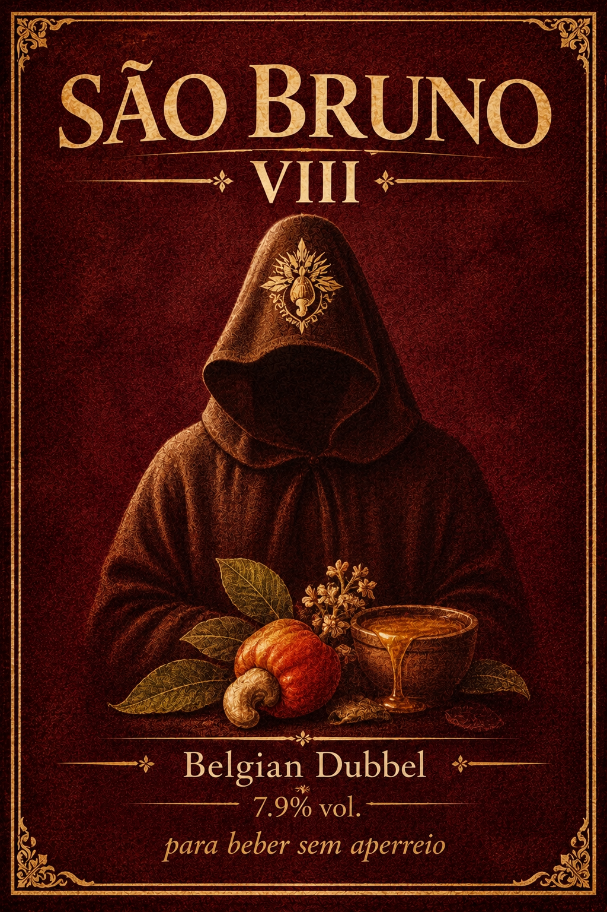
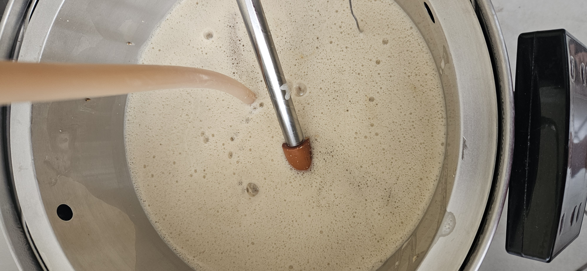
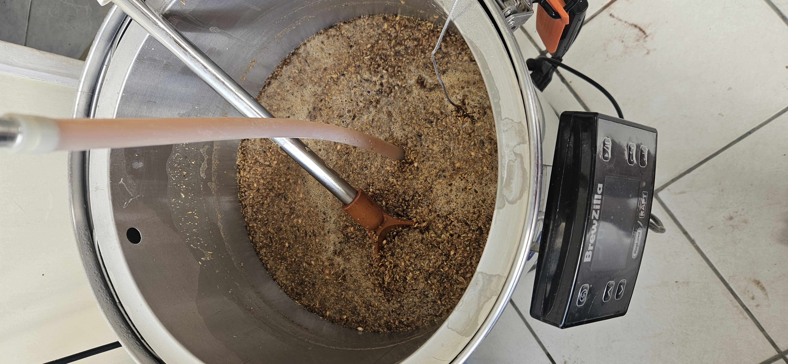
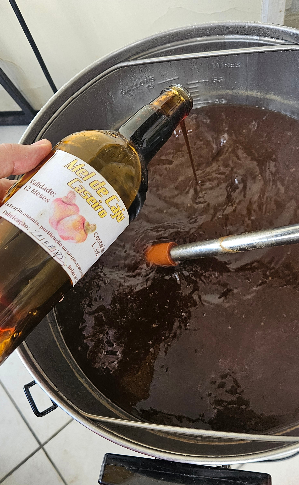
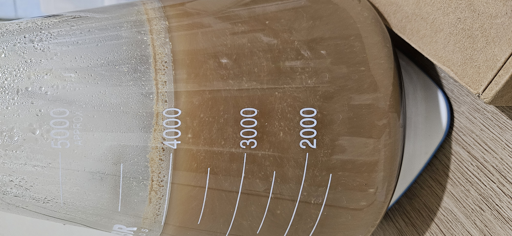

### 🍺 A cerveja - São Bruno VIII

A cerveja alvo desta brassagem é uma *Belgian Dubbel*, uma das cervejas do curso de aprofundamento em cervejas belgas do Jamal. Para dar um toque nordestino, ela leva mel de caju no fim da fervura.

De acordo com o [BJCP de 2021](https://bjcp-brasil.github.io/bjcp-2021-pt-br/), temos que uma *Belgian Dubbel* deve ser:

>  Uma ale belga complexa de cor cobre avermelhada, teor alcoólico moderado, maltada, com sabores maltados ricos, ésteres que remetem a frutas secas ou escuras e uma nota alcoólica combinada a um perfil maltado com final bem seco.

A seguir vejam a composição de malte que eu utilizei nessa receita:

---

### 🌾 Fermentáveis

| Nome                         | Quantidade | % na receita |
| ---------------------------- | ---------: | -----------: |
| Pale Malt - Alto en el Cielo |       6 kg |       48,39% |
| Mel de caju.                 |       2 kg |       16,13% |
| Maris Otter Extra Pale Ale   |       2 kg |       16,13% |
| Malte de Trigo Claro         |       1 kg |        8,06% |
| GoldSwaen Belge              |     0,7 kg |        5,65% |
| Special B                    |     0,7 kg |        5,65% |

Total de grãos/extratos: **12,4 kg**

### 🔥 Perfil de mostura

| Etapa / Nome da mostura | Temperatura | Duração |
| ----------------------- | ----------: | ------: |
| Beta-amilase            |       62 °C |  40 min |
| Alfa-amilase            |       72 °C |  20 min |
| Mash Out                |       78 °C |  10 min |

Mostura escalonada, com uma parada mais longa na beta-amilase para garantir um mosto bem fermentável e o final seco que o estilo pede.

### 🌿 Lupulagem (boil steps / adições) e 🫚 Especiarias

| Nome                      | Quantidade | Tempo de adição |
| ------------------------- | ---------- | --------------- |
| Hallertau Blanc (8,7% AA) | 40 g       | 50 min          |
| Whirlfloc                 | 2 items    | 10 min          |

Além do que está na receita, o mel de caju entrou no fim da fervura.

### 🌡️ Perfil de fermentação

| Etapa                | Temperatura | Duração |
| -------------------- | ----------- | ------- |
| Inoculação           | 18 °C       | —       |
| Fermentação primária | 20 °C       | 6 dias  |
| Clarificação         | 8 °C        | 7 dias  |

### 🧬 Levedura

* **Nome:** BS-22 (Em teoria é a levedura da Rocherfort).
* **Laboratório:** Levteck
* **Quantidade usada no lote:** 1 pkg, propagado antes da brassagem.
* **Attenuation (informada):** \~75-80%

### ⚖️ Comparativo: Estimado (receita) × Medido (lote)

| Parâmetro | Estimado | Medido |
| --------- | -------- | ------ |
| OG        | 1.068    | 1.066  |
| FG        | 1.006    | —      |
| ABV       | 8,14%    | —      |
| IBU       | 19       | —      |
| EBC       | 18,6     | —      |

### 📝 Notas de produção

#### Mostura

Com 10 minutos de mostura medi o pH e ele estava em 4.6, bem abaixo do que eu queria. Para corrigir, adicionei bicarbonato de sódio. Aos 22 minutos a densidade estava em 1.070 e o pH já tinha subido para 4.8. Ao final da parada da beta-amilase o pH estava em torno de 5.1, com densidade de 1.077.

<figure style="margin: auto">
	
	<figcaption>Foto do início da mostura</figcaption>
</figure>

<figure style="margin: auto">
	
	<figcaption>Mostura</figcaption>
</figure>

#### Lavagem

Antes da lavagem a densidade estava em 1.082. Terminei com 51 litros de volume pré-fervura, dois litros a mais do que o esperado, e densidade de 1.049.

#### Fervura

A fervura terminou com 47 litros e densidade de 1.066, bem próxima dos 1.068 estimados. No fim da fervura adicionei o mel de caju.

<figure style="margin: auto">
	
	<figcaption>Adição do mel de caju no fim da fervura</figcaption>
</figure>

#### Fermentação

A levedura Rochefort da Levteck foi propagada antes da brassagem. O mosto foi inoculado a 18 °C, e a fermentação primária deve seguir a 20 °C.

<figure style="margin: auto">
	
	<figcaption>Propagação da levedura</figcaption>
</figure>

### 🍺 A cerveja no copo

Em breve trago atualizações.

### Pontos a melhorar

